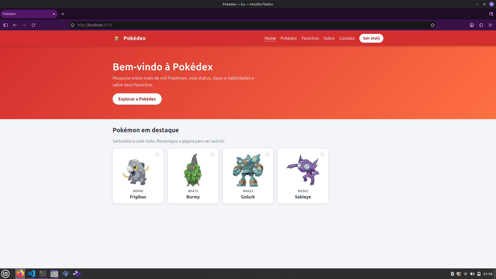
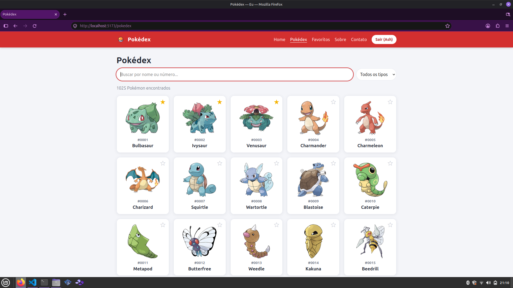
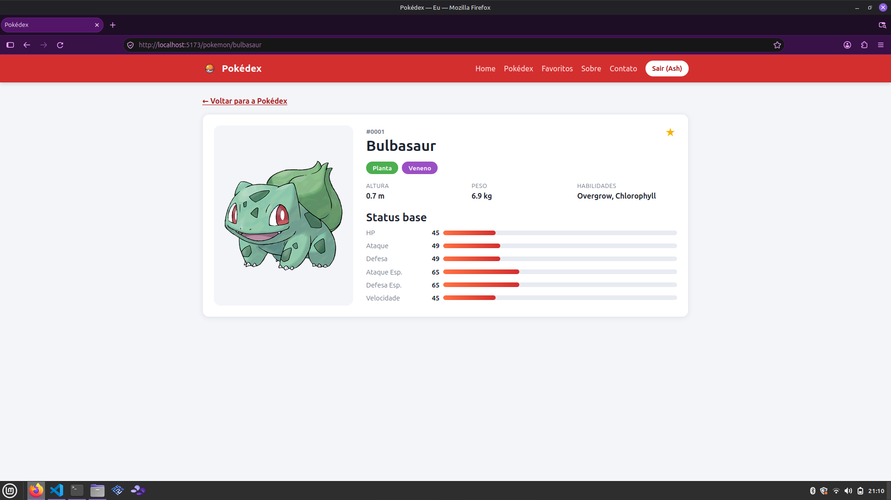
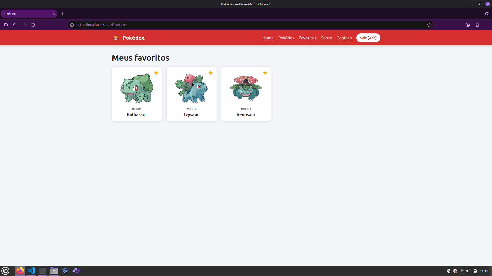
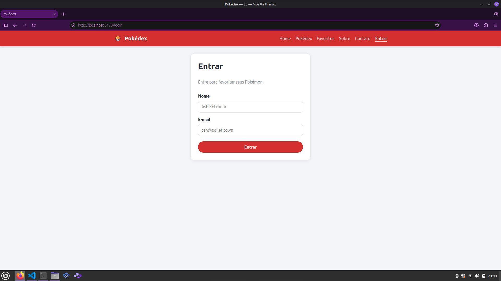
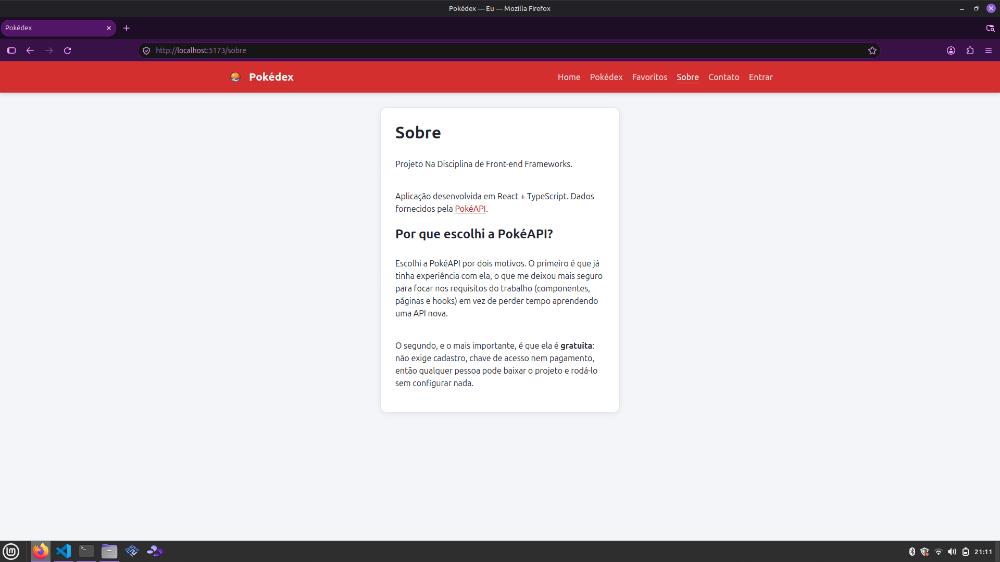
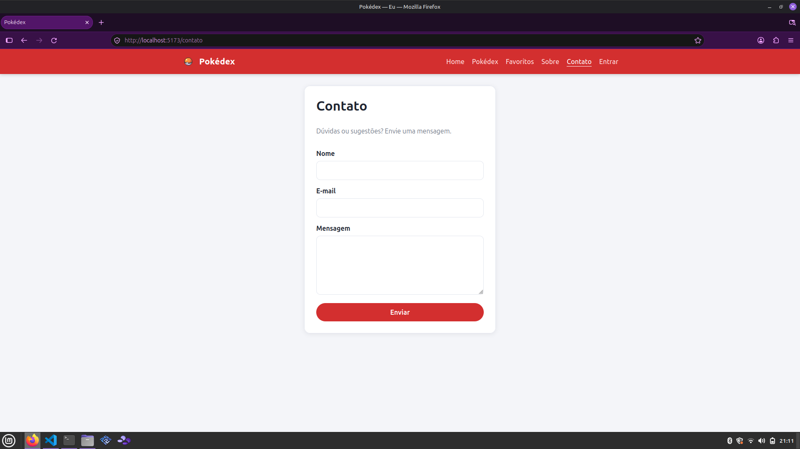

# Pokédex — Trabalho Final de Front-end Frameworks

Aplicação web desenvolvida em **React + TypeScript (Vite)** que consome a [PokéAPI](https://pokeapi.co) para listar, buscar e favoritar Pokémon.

## Integrante

| Nome | Matrícula | Responsabilidade |
| --- | --- | --- |
| **Marcos Paulo Feitosa Espinosa** | 01889041 | Projeto completo (todos os componentes, páginas, hooks e integração com a API) |

## Funcionalidades

- Lista paginada com mais de 1000 Pokémon
- Busca por nome ou número (com *debounce*)
- Filtro por tipo (Fogo, Água, Planta...)
- Página de detalhes com tipos, altura, peso, habilidades e barras de status
- Login simulado (dados salvos no `localStorage`)
- Favoritos (exigem login) que ficam salvos no navegador
- Formulário de contato com validação
- Layout responsivo (celular e computador)

## Requisitos do trabalho

| Requisito | Como foi atendido |
| --- | --- |
| TypeScript obrigatório | Todo o código está em `.ts` / `.tsx` com `strict: true` |
| Mínimo de 8 componentes funcionais | 11 componentes em `src/components` (tabela abaixo) |
| Mínimo de 5 páginas | 7 páginas + página 404 em `src/pages` |
| Mínimo de 4 hooks diferentes | 9 hooks diferentes (tabela abaixo) |
| API real (ponto extra) | Integração com a **PokéAPI** (REST) em `src/services/api.ts` |

## Páginas e rotas

| Rota | Página | Arquivo |
| --- | --- | --- |
| `/` | Home (destaques sorteados) | `src/pages/Home.tsx` |
| `/pokedex` | Lista com busca, filtro e paginação | `src/pages/Pokedex.tsx` |
| `/pokemon/:name` | Detalhes do Pokémon | `src/pages/PokemonDetail.tsx` |
| `/favoritos` | Favoritos (rota protegida) | `src/pages/Favorites.tsx` |
| `/login` | Login | `src/pages/Login.tsx` |
| `/sobre` | Sobre | `src/pages/About.tsx` |
| `/contato` | Contato | `src/pages/Contact.tsx` |
| `*` | Página 404 | `src/pages/NotFound.tsx` |

## Componentes desenvolvidos

Todos desenvolvidos por **Marcos Paulo Feitosa Espinosa**.

| # | Componente | Função |
| --- | --- | --- |
| 1 | `Navbar` | Menu de navegação responsivo, com login/logout |
| 2 | `PokemonCard` | Card com imagem, número e nome do Pokémon |
| 3 | `SearchBar` | Campo de busca (usa `useRef` para foco) |
| 4 | `TypeFilter` | Filtro por tipo |
| 5 | `Pagination` | Controle de páginas |
| 6 | `FavoriteButton` | Botão de estrela para favoritar |
| 7 | `StatBar` | Barra de status (HP, ataque etc.) |
| 8 | `TypeBadge` | Etiqueta colorida do tipo |
| 9 | `Loading` | Indicador de carregamento |
| 10 | `ErrorMessage` | Mensagem de erro com botão "tentar novamente" |
| 11 | `ProtectedRoute` | Bloqueia rotas para usuários não logados |

## Hooks utilizados

| Hook | Onde é usado |
| --- | --- |
| `useState` | Busca, filtro, página, formulários, menu mobile |
| `useEffect` | Foco no campo de busca, reset de página, requisições |
| `useContext` | `useAuth()` e `useFavorites()` (contextos globais) |
| `useRef` | Foco do input em `SearchBar` e `Contact` |
| `useMemo` | Filtro da lista e paginação em `Pokedex`, sorteio em `Home` |
| `useCallback` | Funções dos contextos (`login`, `logout`, `toggleFavorite`) |
| **Custom** `useFetch` | Requisições com `data`, `loading` e `error` |
| **Custom** `useDebounce` | Atraso na busca |
| **Custom** `useLocalStorage` | Persistência de login e favoritos |

## Tecnologias

React 18 · TypeScript · Vite · React Router DOM · PokéAPI · CSS puro

## Como instalar e rodar

Pré-requisito: [Node.js](https://nodejs.org) 18 ou superior.

```bash
git clone https://github.com/marcospaulo0636-commits/Site-Pokedex-react-ts.git
cd Site-Pokedex-react-ts
npm install
npm run dev
```

Abra o endereço mostrado no terminal (normalmente http://localhost:5173).

Para gerar a versão de produção:

```bash
npm run build
npm run preview
```

## Como usar

1. Na **Home**, clique em "Explorar a Pokédex".
2. Na **Pokédex**, pesquise pelo nome ou número e filtre por tipo.
3. Clique em um Pokémon para ver os detalhes.
4. Clique na estrela ☆ para favoritar. Se não estiver logado, você será levado ao **Login** (qualquer nome e e-mail válidos funcionam, pois o login é simulado).
5. Veja seus Pokémon salvos em **Favoritos**.

## Estrutura de pastas

```
src/
├── components/   # 11 componentes reutilizáveis
├── context/      # AuthContext e FavoritesContext
├── hooks/        # useFetch, useDebounce, useLocalStorage
├── pages/        # páginas da aplicação
├── services/     # integração com a PokéAPI
├── types/        # interfaces TypeScript
├── utils/        # funções auxiliares
├── App.tsx       # rotas
├── main.tsx      # ponto de entrada
└── index.css     # estilos
```

## Prints das telas

| Tela | Print |
| --- | --- |
| Home |  |
| Pokédex (lista e busca) |  |
| Detalhes |  |
| Favoritos |  |
| Login |  |
| Sobre |  |
| Contato |  |

## Deploy (opcional)

Link: [COLE AQUI O LINK DA VERCEL]

## Observações

- O login e o formulário de contato são **simulados** (não há servidor próprio); os dados ficam apenas no navegador.
- Os dados dos Pokémon vêm da PokéAPI, que é gratuita e não exige chave.